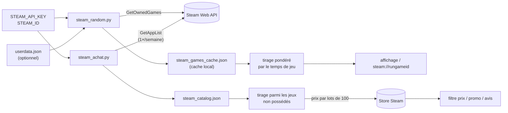

<div align="center">

# 🎲 steam-random

**Tu ne sais pas à quoi jouer ? Laisse le hasard choisir — dans ta bibliothèque ou dans tout le Store.**


</div>

---

## ✨ Deux scripts

### 🎮 `steam_random.py` — un jeu de ta bibliothèque
Tire un jeu au sort parmi ceux que tu possèdes, **pondéré par ton temps de jeu** :

| Mode | Principe | Poids |
|---|---|---|
| `backlog` *(défaut)* | favorise les jeux **peu joués** — idéal pour vider sa pile | `1 / (1 + heures)` |
| `favoris` | favorise les jeux **beaucoup joués** | `√heures` |
| `jamais` | uniquement les jeux **jamais lancés** | — |
| `uniforme` | pur hasard | — |

Filtres : `--min-h` / `--max-h` (heures de jeu), `--exclude` (nom ou AppID), `--top N` (plusieurs propositions), `--launch` (lance directement le jeu via `steam://`), `--seed` (rejouer un tirage).

Les jeux que l'API Steam oublie (gratuits, certains paquets) peuvent être ajoutés avec `--userdata` (voir plus bas).

### 🛒 `steam_achat.py` — un jeu à découvrir sur le Store
Tire au hasard un jeu de **tout le catalogue Steam** que tu **ne possèdes pas encore**, DLC exclus, dans une fourchette de prix :

| Option | Effet |
|---|---|
| `5 15` | entre 5 € et 15 € (prix actuel, promo comprise) |
| `0 0` | uniquement les gratuits |
| `--promo` | uniquement les jeux en promotion |
| `--avis 80` · `--min-avis 100` | au moins 80 % d'avis positifs, au moins 100 avis |
| `--pays FR` | pays des prix |
| `--top 5` · `--ouvrir` | plusieurs jeux · ouvre la page Store du premier |

---

## 🚀 Installer et lancer

Aucune dépendance : Python 3.9+ suffit.

1. Télécharge **`steam-random-1.0.0.zip`** dans la [dernière release](../../releases/latest) (ou clone le dépôt).
2. Crée une **clé API Steam** : https://steamcommunity.com/dev/apikey
3. Steam › Profil › Confidentialité › **Détails des jeux : Public** (sinon l'API renvoie une liste vide).
4. Mets tes identifiants dans l'environnement — **jamais dans le code** :

```zsh
# ~/.zshrc
export STEAM_API_KEY="ta_clé"
export STEAM_ID="ton SteamID64 ou ton pseudo d'URL"
```

```zsh
python3 steam_random.py                          # 1re fois : récupère ta bibliothèque
python3 steam_random.py --offline                # tirages suivants, sans réseau
python3 steam_random.py --offline --mode jamais --top 5
python3 steam_random.py --offline --mode favoris --min-h 2 --launch

python3 steam_achat.py 5 15
python3 steam_achat.py 10 30 --promo --avis 80 --ouvrir
```

**Bibliothèque complète** (jeux absents de l'API) : connecté au Store, enregistre la page
https://store.steampowered.com/dynamicstore/userdata/ sous `userdata.json` à côté des scripts, puis :
`python3 steam_random.py --free --userdata userdata.json`

---

## ⚙️ Comment ça marche



- `steam_random.py` interroge l'API une fois, garde ta bibliothèque en cache, puis tire au sort hors ligne.
- `steam_achat.py` garde le catalogue complet en cache 7 jours, tire des jeux au hasard, puis vérifie leur prix et leurs avis par lots de 100 jusqu'à en trouver un qui convient.

### 🔒 Données personnelles
Les fichiers générés (`userdata.json`, `steam_games_cache.json`, `steam_catalog.json`) contiennent ta bibliothèque : ils restent sur ta machine et sont **exclus du dépôt** (`.gitignore`). La clé API n'est lue que depuis l'environnement (ou `--key`).

---

## 🗂️ Organisation des fichiers

```
steam-random/
├── steam_random.py        tirage dans ta bibliothèque (4 modes, filtres, lancement direct)
├── steam_achat.py         tirage dans le Store (prix, promo, avis, hors jeux possédés)
├── .gitignore             exclut les caches et ta bibliothèque
│
│   créés à l'utilisation (jamais publiés) :
├── steam_games_cache.json ta bibliothèque + temps de jeu
├── steam_catalog.json     catalogue du Store (rafraîchi tous les 7 jours)
└── userdata.json          copie de dynamicstore/userdata (optionnel)
```

---

## 💻 Compatibilité

| | |
|---|---|
| **Systèmes** | macOS, Linux, Windows |
| **Python** | 3.9 ou plus récent, bibliothèque standard uniquement |
| **Compte** | profil Steam avec « Détails des jeux » en public + clé API |

---

## 🧭 Idées pour la suite

- [ ] filtre par genre / tag Steam ;
- [ ] exclure les jeux déjà terminés (succès à 100 %) ;
- [ ] petite interface graphique.

---

<div align="center"><sub>Python, bibliothèque standard, Steam Web API</sub></div>
